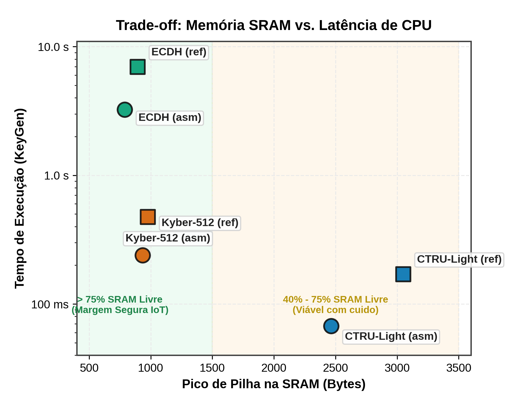
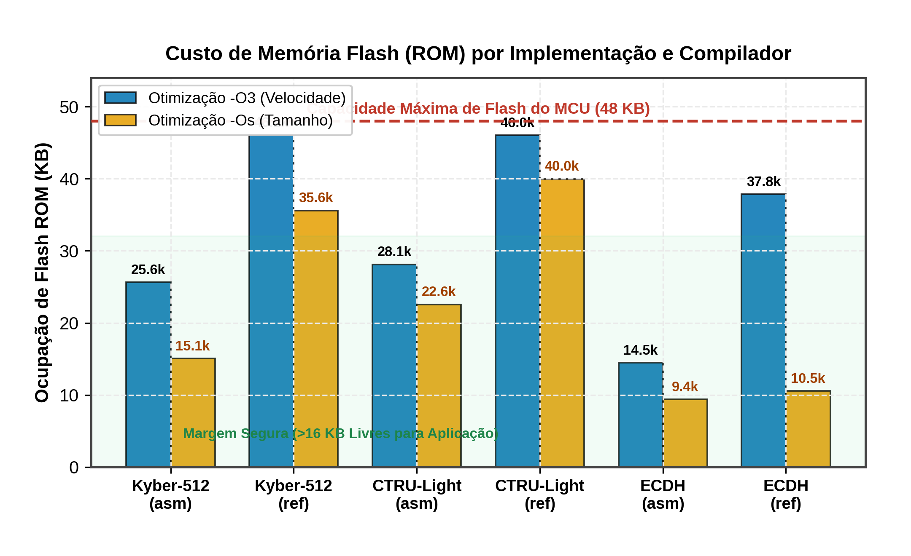
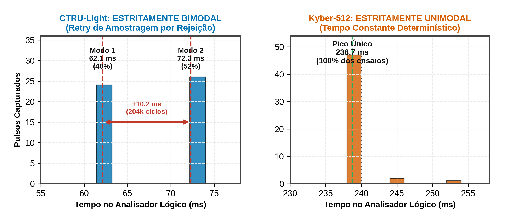

<!-- class: lead -->

# Análise de Desempenho e Consumo Energético de Algoritmos PQC em MCUs de 8 bits
Relatório Parcial de Acompanhamento (Etapa 2)

**Eduardo Silva Abdala**  
*Análise de Desempenho em Sistemas Computacionais (CMP223)*  
Porto Alegre, 2026

---

## 1. O que foi Proposto: Objeto, Hipóteses e Fatores

- **Pergunta Central da Proposta:** qual o limite de aplicabilidade do **Kyber-512** e KEMs pós-quânticos num MCU de 8 bits restrito?
- **Ambiente de Restrição:** Microcontrolador ATmega4809 (6 KB SRAM, 48 KB Flash, 20 MHz).
- **Hipótese:** KEMs pós-quânticos viabilizam execução rápida, mas ameaçam a **margem operacional sistêmica (SRAM e CPU livres)** para tarefas concorrentes (Sensoriamento, MQTT, RTOS).
- **Fatores Fatoriais Avaliados ($3 \times 2 \times 2 \times 3$):**
  - **Algoritmos:** Kyber-512 (NIST) vs. CTRU-Light (LWC) vs. ECDH clássico (controle)
  - **Estratégias:** Código de referência em C puro (`ref`) vs. Assembly otimizado (`asm`)
  - **Otimização do Compilador:** `-O3` (velocidade) vs. `-Os` (tamanho de código)
  - **Fases Criptográficas:** Geração de Chaves (KeyGen), Encapsulação (Encaps) e Decapsulação (Decaps)

---

## 2. Ambiente Experimental e Status das Métricas (DESC & REPRO)

**Bancada Física & Toolchain (DESC & REPRO):**
- **Dispositivo (DUT):** ATmega4809 Curiosity Nano (8 bits, 20 MHz via *fuses*, 6 KB SRAM, 48 KB Flash, 3,3V).
- **Instrumentação:** Analisador Lógico Saleae Logic 8 (100 kS/s) amostrando pino GPIO PA0 (D2).
- **Reprodutibilidade Hermética (NixOS / Flake):** Toolchain declarativa via `flake.nix` pinando `avr-gcc 14`, `avrdude`, Python científico e `pyDOE3` (garantia de compilação idêntica bit a bit).
- **Protocolo:** $N=50$ repetições com PRNG determinístico, script automatizado e logs brutos versionados com hash e timestamp.

| Métrica Prometida | Unidade | Registro Físico | Status Etapa 2 |
| :--- | :---: | :--- | :--- |
| **Latência ($T_{\text{exec}}$)** | ms | Saleae GPIO (`PA0`) | **Concluído ($N=50$)** |
| **Ciclos ($K_{\text{cyc}}$)** | k-ciclos | Mapeado $f_{\text{cpu}} = 20\text{ MHz}$ | **Concluído** |
| **Pilha (Stack)** | Bytes | *Stack Watermarking* (`0xAA`)| **Concluído (12 configs)** |
| **Flash (ROM)** | KB | `avr-size` (`.text` + `.rodata`) | **Concluído** |
| **Margem SRAM** | % / B | $\text{SRAM}_{\text{tot}} - \text{Pico}$ | **Concluído** |
| **Energia ($E_{\text{op}}$)** | $\mu\text{J}$ | Resistor *shunt* + osciloscópio | **Pendente (calibração)** |

- **Mitigação do Observador (BOAS):** Trigger em GPIO isolou ciclos puros da CPU, eliminando o atraso da UART ($+21$ a $+30\text{ ms}$).

---

## 3. Resultados: Latência Pura de CPU no Analisador Lógico

| Algoritmo | Impl. | Otim. | KeyGen (ms) | Encaps (ms) | Decaps (ms) | Speedup ASM |
| :--- | :--- | :--- | ---: | ---: | ---: | :---: |
| **CTRU-Light** | `asm` | `-O3` | **62,1 / 72,3** | **59,1 / 69,2** | **120,3** | $1,55\times - 2,14\times$ |
| **CTRU-Light** | `ref` | `-O3` | 165,0 / 175,3 | 107,9 / 118,1 | 242,1 | — |
| **Kyber-512** | `asm` | `-O3` | **239,3** | **314,5** | **287,2** | $1,83\times - 1,96\times$ |
| **Kyber-512** | `ref` | `-O3` | 475,0 | 598,8 | 590,1 | — |
| **ECDH (Clássico)**| `asm` | `-O3` | **3.248,1** | **6.496,2** | **3.247,4** | $2,13\times - 2,14\times$ |
| **ECDH (Clássico)**| `ref` | `-O3` | 6.957,1 | 13.915,1 | 6.956,4 | — |

*Medição pura na janela GPIO (PA0). A UART adiciona overhead constante de $+21\text{ a }+30\text{ ms}$.*

- **PQC é 10× a 100× mais rápido que o ECDH:** ECDH exige dezenas de milhares de operações de 8 bits para modular curvas elípticas de 256 bits (~65 M ciclos/op).
- **Otimização em Assembly:** Garante ganho consistente de $\approx 2,0\times$ sobre o C puro em todos os esquemas.

---

## 4. Margem Operacional Sistêmica: Sobra SRAM para IoT?

- **Resposta à Pergunta da Proposta:**
  - *O PQC custa memória (SRAM/Flash), não tempo de CPU!*
- **Margem de SRAM Livre (Total: 6 KB):**
  - **ECDH:** consome $826\text{ B}$ $\rightarrow$ **$86,5\%$ de SRAM livre**
  - **Kyber-512:** consome $1.019\text{ B}$ $\rightarrow$ **$83,4\%$ de SRAM livre**
  - **CTRU-Light:** consome $3.177\text{ B}$ $\rightarrow$ **$48,3\%$ de SRAM livre**
- **Conclusão:** Todos os esquemas cabem com folga nos 6 KB do ATmega4809, preservando margem operacional para MQTT, RTOS e sensores.

---

## 5. Custo de Memória Flash (ROM): O Impacto do Assembly e -Os

- **Gargalo Real do PQC em 8 bits: Memória Flash** (teto de 48 KB no MCU)
- **Kyber-512 (ML-KEM):**
  - C de Referência (`-O3`): consome **46,1 KB (96%)**, quase inviabilizando o MCU.
  - Assembly com `-Os`: reduz para **15,1 KB (31%)**, liberando **69% de Flash** para a aplicação!
- **CTRU-Light:** ocupa **22,6 KB** (`asm -Os`), deixando **53% de Flash livre**.
- **ECDH Clássico:** ocupa **9,4 KB** (`asm -Os`), a menor pegada de código.
- **Conclusão:** KEMs pós-quânticos exigem `-Os` e Assembly para permitir coexistência com firmware IoT.

---

## 6. Descoberta Experimental: Bimodalidade no CTRU-Light

- **CTRU-Light (KeyGen & Encaps):** Estritamente bimodal devido ao **retry de amostragem por rejeição** de polinômios ($+10,2\text{ ms} = 204.000\text{ ciclos}$ por nova tentativa).
- **Kyber-512 & ECDH:** Estritamente unimodais de tempo constante (pico único determinístico).
- **Decapsulação:** 100% determinística em todos os esquemas ($120,3\text{ ms}$ no CTRU, sem rejeição).

---

## 7. Modelo Estatístico (ANOVA) & Controle Experimental

- **Modelo Linear:** $\log(\text{Latência}) \sim \text{Algoritmo} \times \text{Implementação} \times \text{Otimização} \times \text{Operação}$ ($R^2 > 0,999$)
- **Frações de variância explicada ($\eta^2$):**
  - **Algoritmo:** explica **86,7%** da variação total da latência
  - **Implementação (`ref` vs `asm`):** explica **9,9%** (fator de ganho $\approx 2,0\times$)
  - **Operação:** explica **1,2%**
  - **Otimização do Compilador (`-O3` vs `-Os`):** explica **$< 0,1\%$** (diferença de 1–4%)
- **Controle experimental (Sem Deriva Térmica):**
  - Ausência de aquecimento/deriva ao longo das 50 repetições consecutivas ($p > 0,05$)
  - Canal UART aferido com baseline `msgcrypt` constante em $41,5\text{ ms}$

---

## 8. Desafios Enfrentados e Ajustes Metodológicos (DIFF)

1. **Atraso no circuito de energia (Shunt/Bateria):**
   - *Ajuste:* Firmware com hooks de trigger pronto; medição de $\mu\text{J}$ movida para a etapa final para uso com shunts calibrados.
2. **Mitigação de ruído na latência do host:**
   - *Ajuste:* Transmissão serial continha até 800 B de pacotes; isolamento total alcançado com a captura de bordas no **Analisador Lógico Saleae via GPIO**.
3. **Timeout do ECDH C puro (~14 segundos):**
   - *Ajuste:* Runner reconfigurado com timeouts dinâmicos proporcionais à complexidade da curva.
4. **Fixação do Clock de 20 MHz:**
   - *Ajuste:* Gravação automática de `fuse2` integrada ao script via UPDI/avrdude.

---

## 9. Próximos Passos (Fechamento da Proposta) & Uso de IA

### Próximos Passos (Entrega Final)
- Realizar as medições de energia por operação ($\mu\text{J}$) com circuito integrador analógico
- Executar a matriz com redução de clock para 10 MHz e 5 MHz
- Concluir a avaliação de consumo de bateria em nós sensores com ciclo ativo/repouso

### Uso de Ferramentas de IA (Req. 5.3)
- **Ambiente:** Antigravity / Claude como assistente de pair programming
- **Atribuições:** Automação de scripts no Saleae, auditoria estatística dos traces brutos e gráficos no padrão de Raj Jain
- **Supervisão humana:** Toda bancada física, medição em hardware e análise teórica concebida e conduzida pelo autor

---

<!-- class: lead -->

# Conclusão & Discussão

- **Resposta à Proposta:** O Kyber-512 e o CTRU-Light não apenas são viáveis em 8 bits, como são até $100\times$ mais rápidos que o ECDH clássico, mantendo mais de $80\%$ de SRAM livre.
- O gargalo reside no binário Flash, solucionado pelo Assembly em `-Os`.

**Obrigado!**  
*Eduardo Silva Abdala — Instituto de Informática (INF-UFRGS)*  

