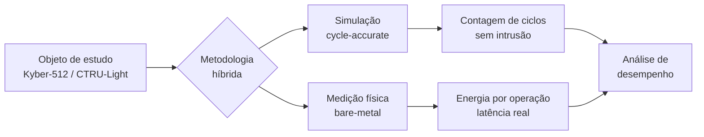
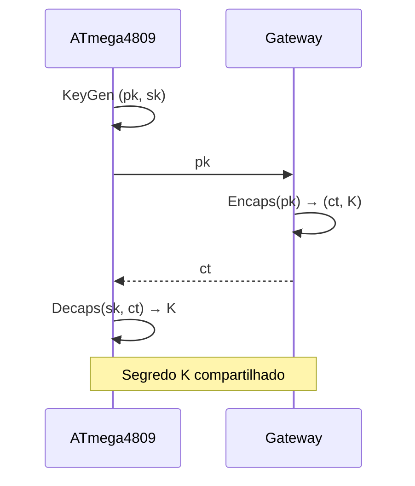
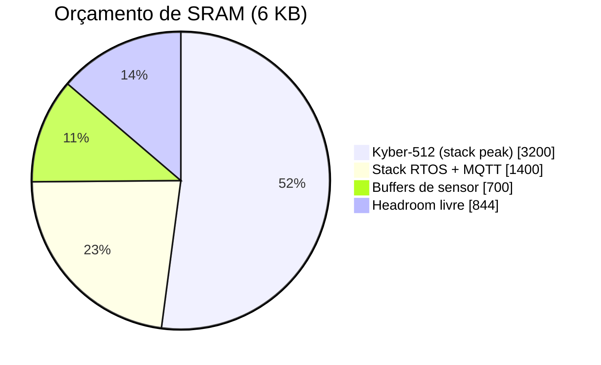
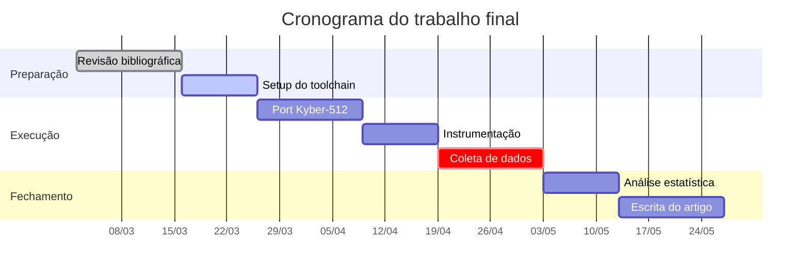

```mermaid
xychart
    title "Ciclos de clock por operação (k-cycles)"
    x-axis ["KeyGen", "Encaps", "Decaps"]
    y-axis "k-cycles" 0 --> 4000
    bar [2650, 3100, 3480]
    bar [1180, 1420, 1560]
```

# Diagramas — CMP223

Cada bloco `mermaid` vira um arquivo em `diagrams/out/`.
O nome sai do comentário `<!-- diagrama: nome -->` logo antes do bloco.

Classes de estilo disponíveis (sufixo `:::`): `destaque`, `alerta`, `neutro`.

---

<!-- diagrama: metodologia-hibrida -->

---

<!-- diagrama: fluxo-kem -->

---

<!-- diagrama: orcamento-sram -->

---

<!-- diagrama: cronograma -->

---

<!-- diagrama: ciclos-por-operacao -->

