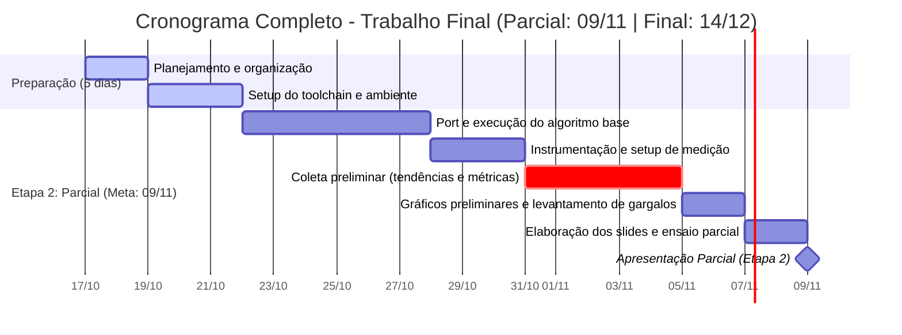
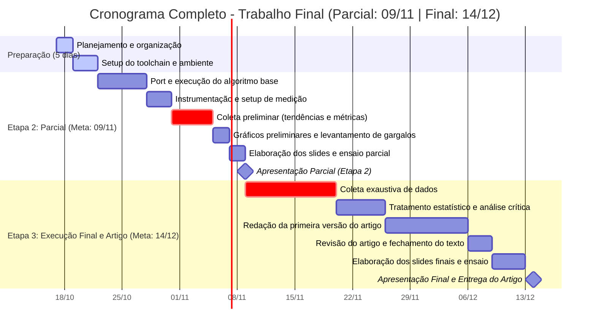
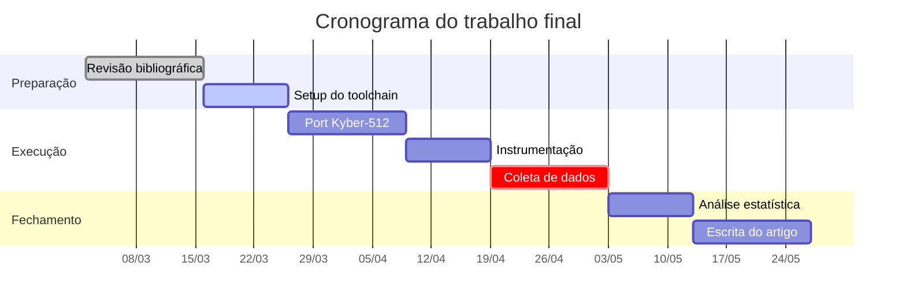
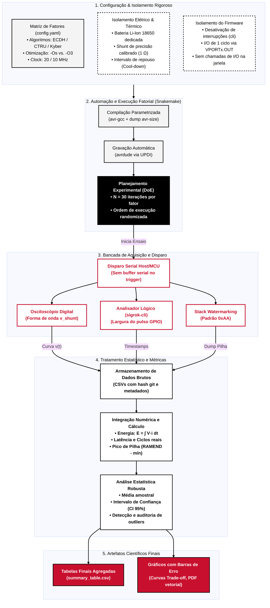
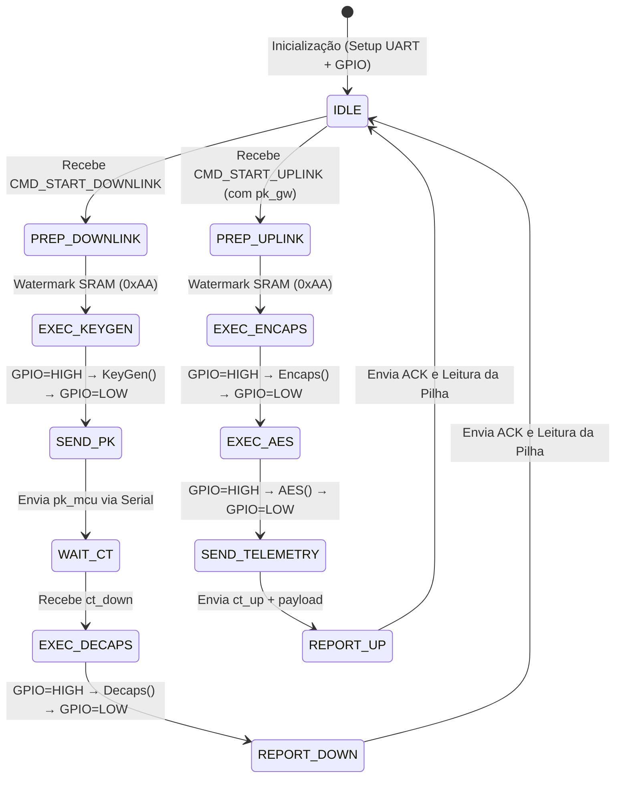
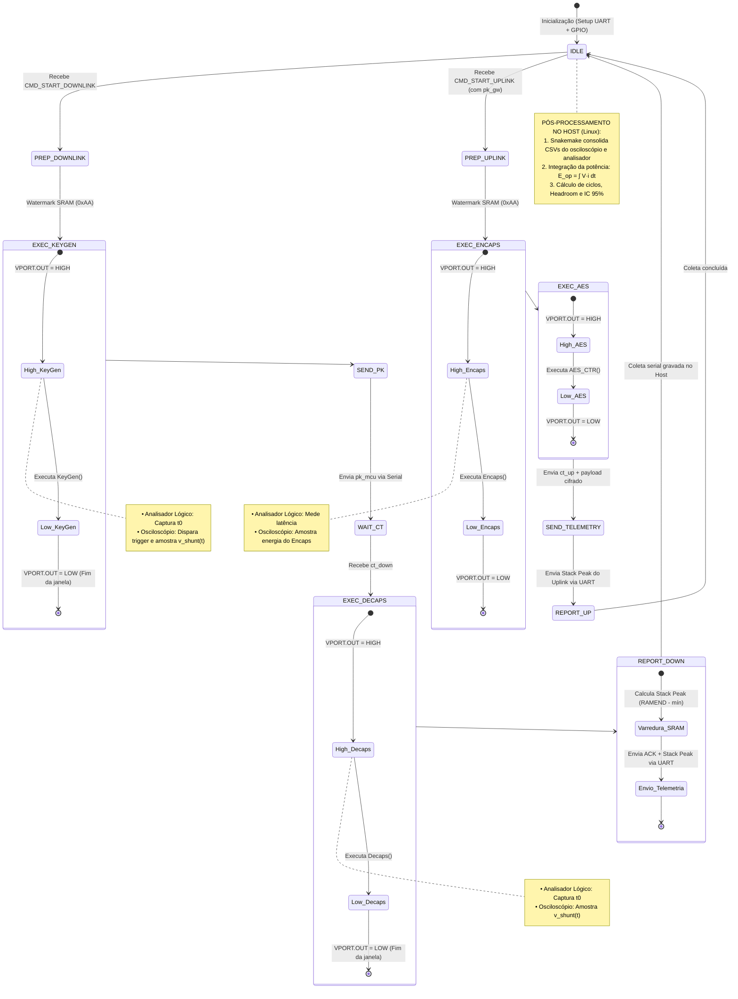
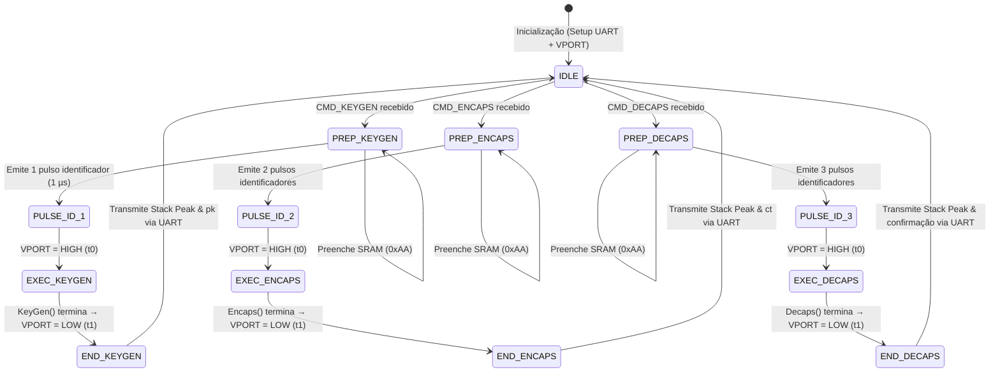

# draft

- ~~Preciso listar o que eu tenho pra fazer no projeto~~
- ~~Preciso organizar qual o nivel de prioridade de cada uma dessas coisas do projeto~~ 
- Preciso definir o que começar primeiro
- ~~Preciso organizar as datas limites para cada uma dessas coisas~~

### Lista
- Organizar o repositorio
- Organizar o codigo
- Definir variaveis do projeto
- Ajustar de que forma o trabalho pode ser reprodutivo
- Organizar Referencias

### Comprar
- Resistor de precisão 1(r) ohm 1%


### Infos Sistem Computacional (SUT)
  Sera utilizado uma devboard Arduino Nano Every, que contem um Microchip ATmega4809 (família megaAVR 0-series, arquitetura AVRxt de 8 bits). 
  - 48 KB Flash, 6 KB SRAM, 256 B EEPROM.
  - Tensão nominal de lógica e alimentação do MCU: 5.0V (regulador on-board MPM3610 converte Vin/USB para 5V).
  - A Nano Every possui um microcontrolador secundário (ATSAMD11D14A) que atua como gravador UPDI e conversor USB-Serial.
  - Single-core, estritamente sequencial (sem hyperthreading, sem execução fora de ordem, sem paralelismo de instruções em nível de hardware).
  - 32 registradores de uso geral de 8 bits (r0 a r31), acessíveis em 1 único ciclo de clock.
  - Os últimos 6 registradores formam 3 pares de ponteiros de 16 bits para indexação indireta de memória: X (r26:r27), Y (r28:r29) e Z (r30:r31).
  - Pipeline: 2 estágios (Fetch e Execute). Enquanto a instrução corrente é executada, a próxima é buscada da Flash. Quase todas as instruções de registradores executam em 1 ciclo de clock. Saltos condicionais (branches) e instruções de acesso à memória (Load/Store) levam de 2 a 3 ciclos.
  - Suporte nativo por hardware apenas para inteiros de 8 bits (adição, subtração, lógica booleana, deslocamento).
  - Multiplicador de Hardware: Multiplicador em silício de 2 registradores de 8 bits gerando resultado de 16 bits em 2 ciclos de clock (MUL, MULS, MULU).
  - Sem suporte a divisão por hardware: Qualquer divisão (e.g., redução modular de polinômios se não for potência de 2) é sintetizada por software via rotinas de shifts sucessivos na avr-libc.
  - Sem FPU (Floating-Point Unit): Qualquer eventual operação em ponto flutuante é emulada via software, gerando explosão de ciclos de clock.
  - Arquitetura Harvard modificada com espaço unificado linear (Unified Memory Mapping

```mermaid
%%{init: {'theme': 'base', 'themeVariables': { 'fontFamily': 'sans-serif', 'lineColor': '#000000', 'textColor': '#000000'}}}%%
flowchart LR
    %% Classes de alto contraste (Preto, Branco e Vermelho UFRGS)
    classDef hardware fill:#000000,stroke:#000000,stroke-width:2px,color:#ffffff,font-weight:bold;
    classDef rotina fill:#ffffff,stroke:#000000,stroke-width:2px,color:#000000,font-weight:bold;
    classDef medicao fill:#ffffff,stroke:#c8102e,stroke-width:2.5px,color:#c8102e,font-weight:bold;
    classDef metrica fill:#ffffff,stroke:#000000,stroke-width:2px,color:#000000,stroke-dasharray: 4 4;
    classDef pipeline fill:#ffffff,stroke:#000000,stroke-width:2px,color:#000000,font-weight:bold;
    classDef headroom fill:#c8102e,stroke:#000000,stroke-width:2px,color:#ffffff,font-weight:bold;

    subgraph SUT [" Sistema Sob Teste "]
        direction TB
        A["ATmega4809<br/>(6 KB SRAM / 48 KB Flash)"]:::hardware
        B["Rotina Criptográfica<br/>(KeyGen / Encaps / Decaps)"]:::rotina
        A --> B
    end

    %% Instrumentação Física
    B -->|"Trigger GPIO"| C("Osciloscópio"):::medicao
    B -->|"Toggle GPIO"| E("Analisador Lógico"):::medicao
    A -->|"Preenchimento 0xAA"| G("Stack Watermarking"):::medicao

    %% Cálculo das Métricas
    C -->|"Integral de Potência"| D["Energia (µJ)<br/>E = ∫ V · i dt"]:::metrica
    E -->|"Largura de Pulso"| F["Latência / Ciclos<br/>T_exec e K_cycles"]:::metrica
    G -->|"RAMEND - End. Mín."| H["Pico de Pilha<br/>Stack Peak (Bytes)"]:::metrica

    %% Pipeline Snakemake & Análise
    subgraph REPRO [" Automação Linux "]
        SNAKE["Orquestrador Snakemake<br/>(Coleta, Parser e Estatística)"]:::pipeline
    end

    D --> SNAKE
    F --> SNAKE
    H --> SNAKE

    %% Síntese
    SNAKE -.-> I["Margem Sistêmica<br/>Headroom CPU e SRAM"]:::headroom

    %% Força contraste fixo em todas as setas
    linkStyle default stroke:#000000,stroke-width:2px;
    linkStyle 10 stroke:#c8102e,stroke-width:2.5px,stroke-dasharray: 4 4;

```












```mermaid
sequenceDiagram
    autonumber
    participant GW as Gateway / Host (PC)
    participant MCU as ATmega4809 (SUT)
    participant INST as Instrumentação (Osciloscópio / LA)

    Note over MCU,GW: === FASE A: RECEPÇÃO NO MCU (KeyGen + Decaps) ===
    
    GW->>MCU: CMD_START_DOWNLINK
    
    rect rgb(240, 248, 255)
        Note over MCU,INST: Medição 1: KeyGen no MCU
        MCU->>INST: GPIO Window = HIGH
        MCU->>MCU: KeyGen() → (pk_mcu, sk_mcu)
        MCU->>INST: GPIO Window = LOW
    end

    Note over MCU,GW: Troca de I/O (Sem medição)
    MCU->>GW: Envia pk_mcu via Serial
    GW->>GW: Encaps(pk_mcu) → (ct_down, K_down)
    GW->>MCU: Envia ct_down via Serial

    rect rgb(240, 248, 255)
        Note over MCU,INST: Medição 2: Decaps no MCU
        MCU->>INST: GPIO Window = HIGH
        MCU->>MCU: Decaps(sk_mcu, ct_down) → K_down
        MCU->>INST: GPIO Window = LOW
    end
    MCU->>GW: ACK_DOWNLINK_OK + Stack Peak (Fase A)

    Note over MCU,GW: === FASE B: ENVIO A PARTIR DO MCU (Encaps) ===

    Note over GW: GW gera seu próprio par assimétrico:<br/>KeyGen() → (pk_gw, sk_gw)
    GW->>MCU: CMD_START_UPLINK + Envia pk_gw

    rect rgb(240, 255, 240)
        Note over MCU,INST: Medição 3: Encaps no MCU
        MCU->>INST: GPIO Window = HIGH
        MCU->>MCU: Encaps(pk_gw) → (ct_up, K_up)
        MCU->>INST: GPIO Window = LOW
    end

    rect rgb(255, 250, 240)
        Note over MCU,INST: Medição 4: Cifragem de Carga Útil (Opcional)
        MCU->>INST: GPIO Window = HIGH
        MCU->>MCU: AES_CTR(K_up, payload) → payload_cifrado
        MCU->>INST: GPIO Window = LOW
    end

    Note over MCU,GW: Troca de I/O (Sem medição)
    MCU->>GW: Envia [ct_up + payload_cifrado]
    GW->>GW: Decaps(sk_gw, ct_up) → K_up
    GW->>GW: AES_Decrypt(K_up, payload_cifrado)
    MCU->>GW: ACK_UPLINK_OK + Stack Peak (Fase B)
  ```

```mermaid
%%{init: {'theme': 'base', 'themeVariables': { 'fontFamily': 'sans-serif', 'lineColor': '#000000', 'textColor': '#000000'}}}%%
flowchart LR
    %% Classes de estilo
    classDef hardware fill:#000000,stroke:#000000,stroke-width:2px,color:#ffffff,font-weight:bold;
    classDef fatores fill:#f4f4f4,stroke:#000000,stroke-width:2px,color:#000000,stroke-dasharray: 3 3;
    classDef medicao fill:#ffffff,stroke:#c8102e,stroke-width:2.5px,color:#c8102e,font-weight:bold;
    classDef processamento fill:#ffffff,stroke:#000000,stroke-width:2px,color:#000000,font-weight:bold;
    classDef metricas fill:#c8102e,stroke:#000000,stroke-width:2px,color:#ffffff,font-weight:bold;

    %% Fatores Experimentais (Variáveis Independentes)
    subgraph FAT [" Variáveis Independentes (Fatores) "]
        direction TB
        F1["Algoritmo: ECDH / CTRU / Kyber"]
        F2["Frequência da CPU: 20 / 10 / 5 MHz"]
        F3["Flags do Compilador: -Os vs. -O3"]
    end
    class FAT fatores

    %% SUT
    subgraph SUT [" Sistema Sob Teste (SUT) "]
        direction TB
        MCU["ATmega4809 (Arduino Nano Every)<br/>48 KB Flash / 6 KB SRAM"]:::hardware
        KERNEL["Rotina Criptográfica<br/>(KeyGen / Encaps / Decaps)"]:::hardware
        MCU --> KERNEL
    end

    FAT -->|"Configuração"| SUT

    %% Instrumentação Física (Camada de Aquisição)
    KERNEL -->|"Queda de Tensão no Shunt"| OSC("Osciloscópio Digital<br/>(Amostragem v_shunt)"):::medicao
    KERNEL -->|"Janela Lógica (GPIO HIGH/LOW)"| LA("Analisador Lógico<br/>(Tempo de Borda a Borda)"):::medicao
    MCU -->|"Varredura de Padrão 0xAA"| WM("Stack Watermarking<br/>(Leitura via Firmware/Serial)"):::medicao

    %% Pipeline Snakemake & Análise
    subgraph AUTO [" Automação & Pós-Processamento "]
        direction TB
        PARSER["Orquestrador Snakemake<br/>• Leitura de CSVs<br/>• Integração Numérica: ∫(V·i)dt<br/>• Estatística (Média, IC 95%)"]:::processamento
    end

    OSC -->|"Forma de Onda (CSV)"| PARSER
    LA -->|"Timestamp Δt (CSV)"| PARSER
    WM -->|"Dump de Memória"| PARSER

    %% Métricas Finais (Variáveis Dependentes)
    subgraph OUT [" Métricas Obtidas (Variáveis Dependentes) "]
        direction TB
        M1["Energia por Operação (E_op em µJ)"]:::metricas
        M2["Latência (ms) e Ciclos (K_cycles)"]:::metricas
        M3["Pico de SRAM (Stack Peak em Bytes)"]:::metricas
        M4["Headroom Operacional (CPU e SRAM Livres %)"]:::metricas
    end

    PARSER --> OUT

    %% Ajuste de estilo das conexões
    linkStyle default stroke:#000000,stroke-width:2px;
``` 







