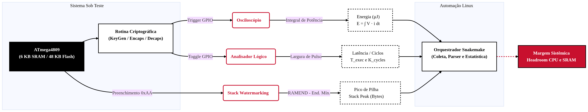

<!-- class: lead -->

# Análise de Desempenho e Consumo Energético de Algoritmos PQC em MCUs de 8 bits
Proposta de Trabalho Final

**Eduardo Silva Abdala**  
*Computer System Performance Analysis (CMP223)*  
Porto Alegre, 2026

---

## Objeto Computacional

- **Objeto de Estudo:** Kyber-512 (ML-KEM, padrão NIST) vs. CTRU-Light (LWC), com ECDH clássico como linha de base de controle.
- **Ambiente de Restrição:** Microcontrolador ATmega4809 (6 KB de SRAM, 48 KB de Flash, 20Mhz).
- **Problema:** Padrões PQC globais foram pensados para sistemas modernos, negligenciando as limitações físicas de MCUs legados e ou restritos.
- **Objetivo:** Determinar o limite de aplicabilidade do Kyber-512, quantificando o custo energético e avaliando a margem operacional (CPU e SRAM livres) para tarefas concorrentes (Sensoriamento, MQTT, RTOS).

---

## Fatores de Comparação e Variáveis

- **Algoritmos:** ECDH vs. CTRU-Light vs. Kyber-512.
- **Estratégias de Implementação:** Código de referência em C puro vs. Assembly otimizado.
- **Fase Criptográfica:** Geração de Chaves (KeyGen), Encapsulamento (Encaps) e Desencapsulamento (Decaps).

---

## Método de Análise e Justificativa

- **Método Selecionado:** Medição.
- **Justificativa da Escolha:**
  - **Fidelidade:** Captura transições reais de corrente e o dreno de bateria.
  - **Mitigação do Efeito do Observador:** Instrumentação externa (*shunt*, osciloscópio, analisador lógico e *Stack Watermarking*).

---

## Diagrama da Metodologia e Pipeline

---

<!-- ## Métricas -->

<!-- - **Consumo Energético ($E_{\text{op}}$ em $\mu\text{J}$):**
  - *Registro:* Queda de tensão em resistor *shunt* via osciloscópio, com *trigger* em pino GPIO.
  - *Cálculo:* $E_{\text{op}} = \int_{t_0}^{t_1} V_{\text{cc}} \cdot \left(\frac{v_{\text{shunt}}(t)}{R_{\text{shunt}}}\right) dt$.
- **Tempo de Execução e Latência ($T_{\text{exec}}$ e $K_{\text{cycles}}$):**
  - *Registro:* Analisador lógico em pino de *toggle* GPIO ($T_{\text{exec}} = t_1 - t_0$).
  - *Cálculo:* $K_{\text{cycles}} = (T_{\text{exec}} \cdot f_{\text{cpu}}) / 1000$.

---

- **Footprint de Memória (Stack Peak e ROM):**
  - *Registro & Cálculo:* *Stack Watermarking* ($\text{RAMEND} - \text{Endereço Mínimo}$) e `avr-size`.
- **Margem Operacional Sistêmica (Headroom %):**
  - *Cálculo:* $\text{CPU}_{\text{livre}} = (1 - T_{\text{exec}}/T_{\text{ciclo}}) \times 100$ e $\text{SRAM}_{\text{livre}} = \text{SRAM}_{\text{total}} - (\text{Stack Peak} + \text{SRAM}_{\text{estática}})$. -->

<!-- --- -->

| Métrica | Und. | Procedimento de Registro | Cálculo |
| :--- | :---: | :--- | :--- |
| **Energia** ($E_{\text{op}}$) | $\mu\text{J}$ | Resistor *shunt* + osciloscópio (GPIO *trigger*) | $\int_{t_0}^{t_1} V_{\text{cc}} \cdot \frac{v_{\text{shunt}}(t)}{R_{\text{shunt}}} dt$ |
| **Latência** ($T_{\text{exec}}$) | ms | Analisador lógico em *toggle* GPIO | $t_1 - t_0$ |
| **Ciclos** ($K_{\text{cycles}}$) | k-ciclos | Base de tempo com $f_{\text{cpu}}$ fixo | $(T_{\text{exec}} \cdot f_{\text{cpu}}) / 1000$ |
| **Pilha** (Stack) | Bytes | *Stack Watermarking* (padrão `0xAA`) | $\text{RAMEND} - \text{End}_{\text{mín}}$ |
| **Código** (ROM) | KB | Inspeção estática de binário compilado | `avr-size` (`.text` + `.rodata`) |
| **CPU Livre** | % | Janela operacional do nó ($T_{\text{ciclo}}$) | $(1 - T_{\text{exec}}/T_{\text{ciclo}}) \times 100$ |
| **SRAM Livre** | % / B | Margem física de memória volátil | $\text{SRAM}_{\text{tot}} - (\text{Stack} + \text{Static})$ |

---

<!-- class: lead -->

# Perguntas & Sugestões

**Eduardo Silva Abdala**  
*Instituto de Informática - UFRGS*

