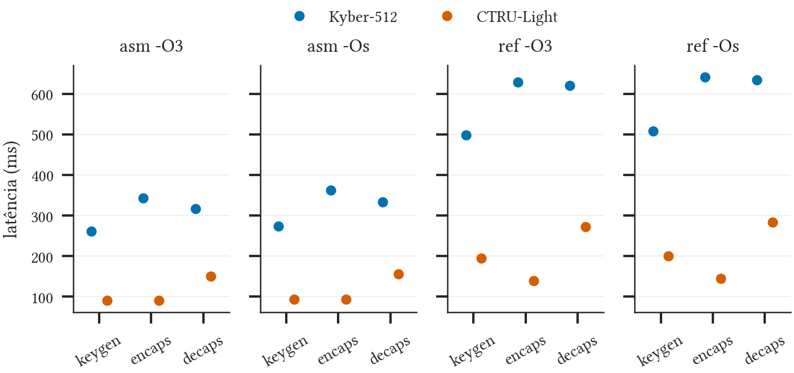
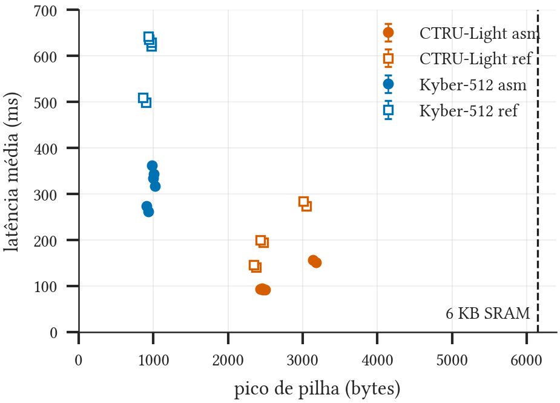

<!-- class: lead -->

# Avaliação de Desempenho de Criptografia Pós-Quântica em Sistemas Embarcados
Relatório Parcial (Etapa 2)

**Eduardo Silva Abdala**
*Análise de Desempenho em Sistemas Computacionais (CMP223)*
Porto Alegre, 2026

---

## Ambiente de teste (DESC)

- **SUT:** Arduino Nano Every, ATmega4809 (AVRxt 8 bits, 48 KB Flash, 6 KB SRAM), 5 V, 20 MHz
- **Firmware:** bare-metal, interrupções off na janela de medição, telemetria via UART fora dela
- **Algoritmos:** Kyber-512 (ML-KEM) e CTRU-Light, cada um em C de referência e assembly AVR
- **Toolchain:** avr-gcc + avrdude (UPDI), ambiente fixado em `flake.nix`
- **Métricas coletadas:** latência (host, até o 1º byte serial), pico de pilha (watermark `0xAA`), Flash (`.hex`)
- **Energia:** pendente. O integrador `E = ∫V·i dt` já está implementado e aguarda shunt de 1 Ω e bateria

---

## Projeto experimental e boas práticas (DOE / BOAS)

- Fatorial completo gerado por código (`design.py`, pyDOE3): algoritmo × variante × otimização × operação
- Ordem **aleatorizada** com semente fixa, registrada em `schedule.json`
- Uma pasta por experimento: binários, telemetria bruta, cronograma
- `catalog.py` classifica cada pasta **pela evidência** (bench / sim / vazia). Só bancada entra na análise
- Controle: `msgcrypt` (AES, o mesmo código em todos os firmwares) fica estável em 38,4–39,2 ms (-O3)

---

## Reprodutibilidade e programação literal (REPRO / LITERAL / DSBOX)

- Caderno `src/analysis/analise.ipynb`: do JSON bruto às tabelas, figuras e ANOVA, com interpretação
- Re-execução: `jupyter nbconvert --execute` (dependências fixadas em `requirements-notebook.txt`)
- pandas · seaborn · statsmodels · scipy
- O caderno gera as tabelas e figuras do artigo (template ACM)

---

## Resultados preliminares: latência (média ± IC 95%, 20 MHz)

| Alg. | Var. | Opt. | KeyGen (ms) | Encaps (ms) | Decaps (ms) | Pilha (B) | Flash (B) |
| :--- | :--- | :--- | ---: | ---: | ---: | ---: | ---: |
| Kyber-512 | asm | -O3 | 261,7 ± 0,3 | 343,6 ± 0,2 | 317,0 ± 0,2 | 1019 | 26256 |
| Kyber-512 | asm | -Os | 274,1 ± 0,4 | 362,3 ± 0,5 | 334,2 ± 0,4 | 997 | 15414 |
| Kyber-512 | ref | -O3 | 498,3 ± 0,5 | 629,0 ± 0,5 | 621,0 ± 0,5 | 976 | 47200 |
| CTRU-Light | asm | -O3 | 91,0 ± 1,6 | 91,4 ± 1,4 | 151,1 ± 0,1 | 3177 | 28794 |
| CTRU-Light | asm | -Os | 93,4 ± 1,7 | 93,9 ± 1,5 | 156,5 ± 0,4 | 3137 | 23116 |
| CTRU-Light | ref | -O3 | 194,7 ± 3,7 | 140,0 ± 3,1 | 272,8 ± 0,2 | 3049 | 47140 |

2000 observações de bancada. Tabela completa em `artigo/tables/results.tex`.

---

## Resultados preliminares: o que os dados mostram

- **ANOVA (log T):** algoritmo ≈ 58% e variante ≈ 34% da variação. Otimização < 0,1%. R² > 0,99
- **asm vs ref:** 1,5× a 2,1× mais rápido e até 21 KB a menos de Flash
- **-Os vs -O3:** 2–5% mais lento, 6 a 11 KB a menos de Flash
- **CTRU-Light vs Kyber:** 2,1× a 4,5× mais rápido, mas usa ~3× mais pilha (48% vs 84% de SRAM livre)

---

## Trade-off memória × tempo

Kyber `ref -O3` deixa só 4% da Flash livre: sem assembly, praticamente não sobra espaço para a aplicação.

---

## Dificuldades encontradas e soluções (DIFF)

1. **Shunt e bateria ainda não chegaram.** Energia fica como `NA`. O pipeline de integração está pronto e foi validado offline
2. **Dados simulados misturados com os reais.** Proveniência gravada em cada observação, modo no nome da pasta, e `catalog.py` para auditar
3. **Energia "estimada" com corrente constante** em versões antigas do runner. Removida: nunca reportar valor não medido
4. **Execuções interrompidas** (8 pastas vazias). O runner agora falha de forma explícita. As pastas foram mantidas e catalogadas
5. **Fuse de clock** (16 vs 20 MHz). Gravação de `fuse2` junto com o flash
6. **Distribuição bimodal** em keygen/encaps do CTRU-Light (CV 3–6%). Causa a investigar

---

## Próximos passos

- Instalar shunt + bateria e medir energia por operação
- Coletar 10 e 5 MHz (fator clock) e o baseline ECDH na bancada
- Medir a latência pelo pulso GPIO no analisador lógico (sem overhead serial)
- Balancear as células (N = 30 por combinação)

---

## Uso de IA (Requisito 5.3)

- **Agente:** Kiro (Claude Opus), em modo autônomo no repositório, com tarefas pedidas uma a uma
- **Fluxo:** pedido → implementação pelo agente → revisão humana do diff e re-execução → integração
- **Com auxílio de IA:** revisão do projeto, separação sim/bench, `catalog.py`, caderno de análise, migração do artigo para ACM, estes slides
- Detalhes na Seção "Uso de ferramentas de IA" do artigo

---

<!-- class: lead -->

# Perguntas & Discussão

**Eduardo Silva Abdala**
*Instituto de Informática - UFRGS*
