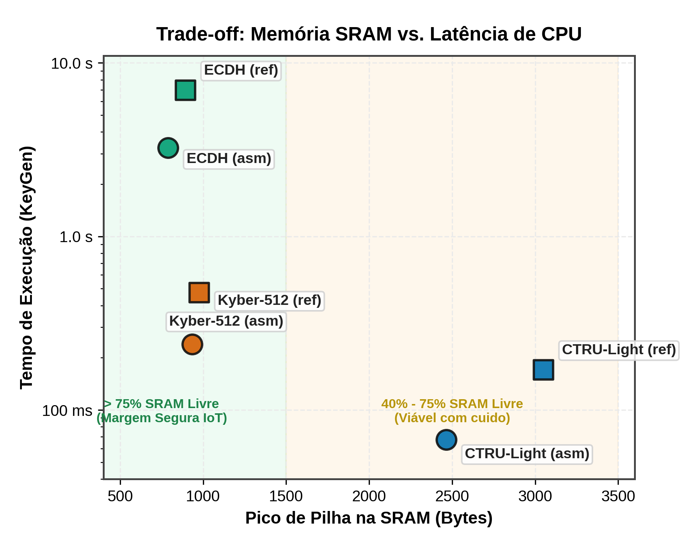
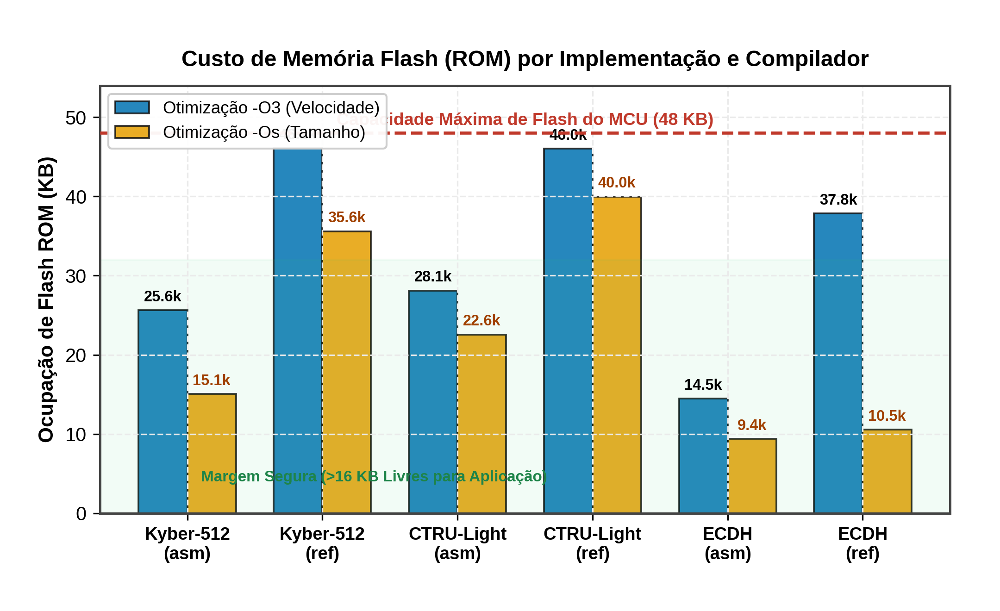
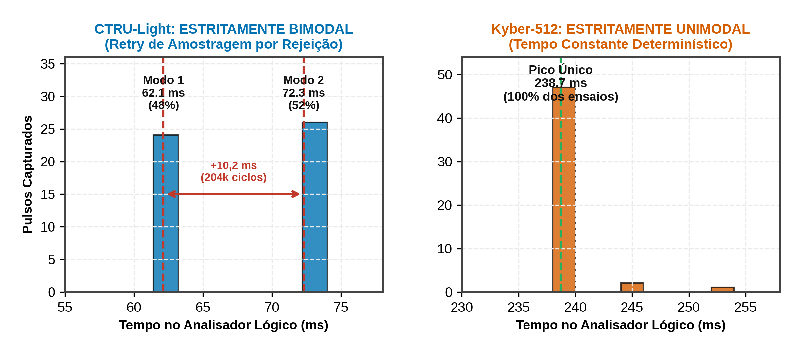

<!-- class: lead -->

# Análise de Desempenho e Consumo Energético de Criptografia Pós-Quântica em MCUs de 8 bits
Relatório Parcial de Acompanhamento

**Eduardo Silva Abdala**  
*Análise de Desempenho em Sistemas Computacionais (CMP223)*  
Porto Alegre, 2026

---

## 1. O que foi Proposto: Objeto e Fatores

- **Pergunta Central:** Qual o limite de viabilidade do **Kyber-512** e KEMs pós-quânticos num microcontrolador de 8 bits restrito?
- **Ambiente de Restrição:** **ATmega4809** (8 bits, 6 KB SRAM, 48 KB Flash, 20 MHz).
<!-- - **Hipótese:** O PQC não sobrecarrega a CPU, mas ameaça a **reserva de Flash e SRAM** para tarefas concorrentes de nós IoT. -->
- **Projeto Fatorial Completo (3 × 2 × 2 × 3):**
  - **Algoritmos:** Kyber-512 (NIST) vs. CTRU-Light (LWC) vs. ECDH clássico
  - **Implementações:** Assembly AVR otimizado (`asm`) vs. C puro de referência (`ref`)
  - **Compilador:** `-O3` (velocidade) vs. `-Os` (tamanho)
  - **Fases:** Geração de Chaves (KeyGen), Encapsulação (Encaps) e Decapsulação (Decaps)

---

## 2. Bancada Física e Status das Métricas

**Bancada & Reprodutibilidade:**
- **DUT:** Arduino Nano Every com ATmega4809 (8-bit single-core, 20 MHz, 6 KB SRAM, 48 KB Flash).
- **Instrumentação:** Analisador Lógico 8ch 24 MHz via GPIO PA0 (D2).
- **Mitigação do Observador:** Janela física na GPIO removeu o atraso da serial/USB (+21 a +30 ms).
- **NixOS Flake:** Toolchain declarativa (`avr-gcc 13`, `pyDOE3`).
- **Amostragem:** N = 30 por célula (1.440 ensaios).

| Métrica Prometida | Unidade | Instrumento | Status Etapa 2 |
| :--- | :---: | :--- | :---: |
| **Latência ($T_{\text{exec}}$)** | ms | Analisador Lógico | **Concluído** |
| **Ciclos ($K_{\text{cyc}}$)** | k-ciclos | Mapeado @ 20 MHz | **Concluído** |
| **Pilha (Stack)** | Bytes | *Watermarking* `0xAA` | **Concluído** |
| **Flash (ROM)** | KB | `avr-size` binário | **Concluído** |
| **Margem SRAM** | % / B | $\text{SRAM} - \text{Pico}$ | **Concluído** |
| **Energia ($E_{\text{op}}$)** | $\mu\text{J}$ | Resistor *shunt* | **Pendente (calibração)** |

---

## 2b. Montagem Experimental & Captura Física Real

- **Isolamento de Medição:** A janela de nível lógico na GPIO reduz o atraso introduzido pela porta serial/USB (+21 a +30 ms).

---

## 2c. Reprodutibilidade, Controle e Análise de Dados

- **Reprodutibilidade:** Ambiente fixo via Nix (`avr-gcc 13`) com binários, logs e sinais brutos salvos por execução.
- **Projeto Experimental:** Matriz de testes gerada automaticamente por código (`config.yaml` + `design.py` + `seed=42`).
- **Controle Experimental:** Clock fixo em 20 MHz, medição via pino físico (sem atraso serial) e *stack watermarking* (`0xAA`).
- **Programação Literária:** Caderno Quarto em R (`analise.qmd`) e ingestão bruta (`prepare.py`).
- **Ciência de Dados:** Dados em formato *tidy* (`tidyverse`), gráficos com **`ggplot2`** (`tikzDevice`/`ragg`) e estatística em R (`car`, `emmeans`).
<!-- 
| Ordem (`Run #`) | Algoritmo | Variante | Flag | Operação | Latência LA (ms) | Pico Pilha (B) | Status |
| :---: | :--- | :---: | :---: | :--- | ---: | ---: | :---: |
| **#1** | `ctru-light` | `ref` | `-O3` | `decaps` | 241,07 | 3.046 | OK |
| **#3** | `ctru-light` | `ref` | `-Os` | `encaps` | 108,53 | 2.346 | OK |
| **#4** | `ctru-light` | `ref` | `-O3` | `keygen` | 172,59 | 2.472 | OK |
| **#6** | `ecdh` | `asm` | `-Os` | `msgcrypt` | 0,02 | 36 | OK |
| **#10** | `kyber512` | `asm` | `-O3` | `encaps` | 314,48 | 1.018 | OK |
| **#11** | `kyber512` | `ref` | `-Os` | `encaps` | 616,24 | 937 | OK | -->

---

## 3. Resultados: Coleta via Analisador Lógico

| Algoritmo | Implementação | KeyGen (ms) | Encaps (ms) | Decaps (ms) | Speedup Assembly |
| :--- | :---: | ---: | ---: | ---: | :---: |
| **CTRU-Light** | `asm` (Assembly) | **67,2** | **61,1** | **119,5** | **2,02×** |
| CTRU-Light | `ref` (C puro) | 167,9 | 109,4 | 241,1 | — |
| **Kyber-512** | `asm` (Assembly) | **239,4** | **314,7** | **287,3** | **1,89× – 2,04×** |
| Kyber-512 | `ref` (C puro) | 471,3 | 594,3 | 585,7 | — |
| **ECDH (Clássico)**| `asm` (Assembly) | **3.179,6** | **6.360,1** | **3.179,9** | **2,19×** |
| ECDH (Clássico)| `ref` (C puro) | 6.978,5 | 13.958,4 | 6.977,8 | — |

- **Valores Medidos:** Operações em anéis polinomiais (Kyber e CTRU) situam-se entre 60 ms e 1.064 ms, enquanto a curva elíptica clássica de 256 bits varia de 3.180 ms a 13.958 ms.

---

## 4. Ocupação de Memória SRAM

- **Comportamento Observado:** O consumo de pilha (*stack watermarking*) e variáveis globais permaneceu abaixo de 2,5 KB em todas as configurações avaliadas.
- **SRAM Livre (Total: 6 KB):** **ECDH** consome 777 B (87% livre); **Kyber-512** consome 946 B (85% livre); **CTRU-Light** consome 2.464 B (60% livre).

---

## 5. Ocupação de Memória Flash (ROM)

- **Limite Físico da Plataforma:** 48 KB de memória Flash no ATmega4809.
- **Variação por Configuração:** O Kyber-512 em C de referência ocupa **44,5 KB (93%)**, enquanto a versão em Assembly com `-Os` ocupa **13,9 KB (29%)**.
- **Impacto de Otimização:** O flag de compilação `-Os` reduz substancialmente o tamanho do binário quando comparado a `-O3`, sem prejuízo expressivo na latência de execução.

---

## 6. Distribuição Temporal: Bimodalidade no CTRU-Light

- **CTRU-Light (KeyGen/Encaps):** Distribuição bimodal registrada experimentalmente, associada ao laço de amostragem por rejeição (Δt ≈ +10 ms / ~220.000 ciclos por reamostragem).
- **Kyber-512:** Perfil unimodal estrito e tempo constante nas três operações.
- **Decapsulação:** Comportamento unimodal em todos os esquemas analisados (desvio padrão < 0,1 ms).

---

## 7. Desafios Enfrentados e Soluções

1. **Eliminação do Ruído Serial (UART):** A serial adicionava +21 a +30 ms; isolamento completo alcançado com janela GPIO PA0 amostrada no Analisador Lógico.
2. **Computação Longa do ECDH C puro (~14s):** Multiplicações de 256 bits em 8 bits causavam falsos timeouts; *runner* reconfigurado com timeouts dinâmicos de 35s.
3. **Estouro de Flash no CTRU-Light C ref:** `-O3` excedeu a Flash por 148 B; solucionado com *-mrelax* (*linker relaxation*) e *-mcall-prologues*, liberando >1,5 KB.

---

## 8. Próximos Passos & Uso de IA

### Próximos Passos (Entrega Final)
- Calibração do circuito com resistor *shunt* e medição de energia por operação (µJ)
- Avaliação com redução de clock para 10 MHz e 5 MHz

### Uso de Ferramentas de IA (Req. 5.3)
- **Ambiente:** Claude como assistente de pair programming
- **Atribuições:** Refatoração de pegada de Flash do Kyber C ref (de 79 KB para 44 KB), automação no sigrok
- **Supervisão humana:** Concepção da bancada, medições em hardware e interpretação teórica

---

<!-- class: lead -->

# Síntese do Andamento Parcial

- **Estado da Bancada:** 1.440 ensaios concluídos com instrumentação física (latência via LA, ciclos, stack watermarking e Flash).
- **Evidências Experimentais:** Dispersão temporal bimodal no CTRU decorrente de rejeição vs. tempo constante no Kyber.
- **Fase Seguinte:** Medição experimental de consumo energético por operação (µJ) e consolidação da análise comparativa final.

**Obrigado!**  
*Eduardo Silva Abdala — Instituto de Informática (INF-UFRGS)*  

