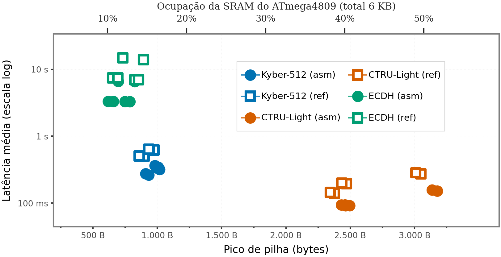
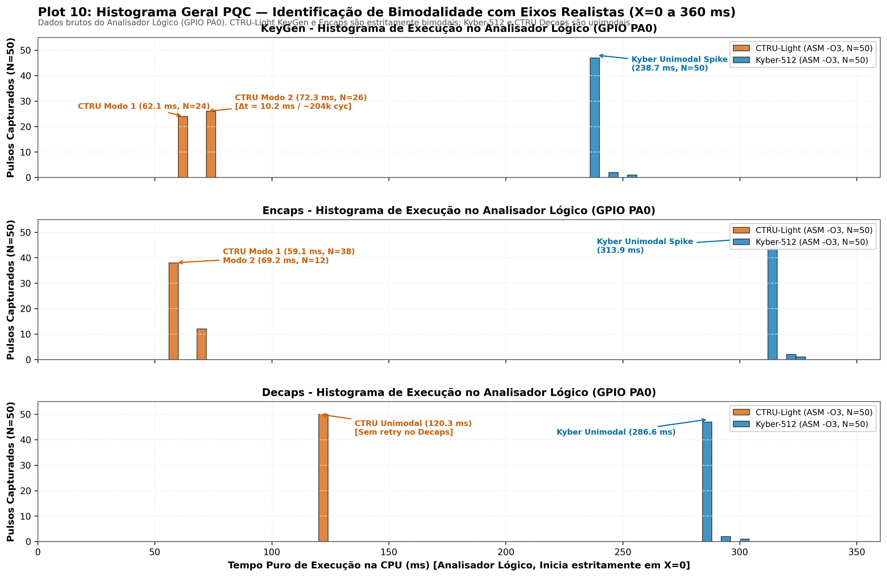

<!-- class: lead -->

# Análise de Desempenho e Consumo Energético de Algoritmos PQC em MCUs de 8 bits
Relatório Parcial de Acompanhamento (Etapa 2)

**Eduardo Silva Abdala**  
*Análise de Desempenho em Sistemas Computacionais (CMP223)*  
Porto Alegre, 2026

---

## 1. O que foi Proposto: Objeto, Hipóteses e Fatores

- **Pergunta Central da Proposta:** qual o limite de aplicabilidade do **Kyber-512** e KEMs pós-quânticos num MCU de 8 bits restrito?
- **Ambiente de Restrição:** Microcontrolador ATmega4809 (6 KB SRAM, 48 KB Flash, 20 MHz).
- **Hipótese:** KEMs pós-quânticos viabilizam execução rápida, mas ameaçam a **margem operacional sistêmica (SRAM e CPU livres)** para tarefas concorrentes (Sensoriamento, MQTT, RTOS).
- **Fatores Fatoriais Avaliados ($3 \times 2 \times 2 \times 3$):**
  - **Algoritmos:** Kyber-512 (NIST) vs. CTRU-Light (LWC) vs. ECDH clássico (controle)
  - **Estratégias:** Código de referência em C puro (`ref`) vs. Assembly otimizado (`asm`)
  - **Otimização do Compilador:** `-O3` (velocidade) vs. `-Os` (tamanho de código)
  - **Fases Criptográficas:** Geração de Chaves (KeyGen), Encapsulação (Encaps) e Decapsulação (Decaps)

---

## 2. Metodologia: Status das Métricas Prometidas na Proposta

| Métrica Prometida | Unidade | Procedimento de Registro (Proposta) | Status no Relatório Parcial |
| :--- | :---: | :--- | :--- |
| **Latência ($T_{\text{exec}}$)** | ms | Analisador lógico em toggle GPIO (`D2`) | **Concluído:** $N=50$ via Saleae (100 kHz) |
| **Ciclos ($K_{\text{cycles}}$)** | k-ciclos | Base de tempo $f_{\text{cpu}} = 20\text{ MHz}$ | **Concluído:** mapeado diretamente da CPU |
| **Pilha (Stack Peak)** | Bytes | *Stack Watermarking* (`0xAA`) | **Concluído:** medido em todas as 12 configs |
| **Código (ROM)** | KB | `avr-size` (`.text` + `.rodata`) | **Concluído:** analisado no mapa de memória |
| **Margem de SRAM** | % / B | $\text{SRAM}_{\text{livre}} = \text{SRAM}_{\text{tot}} - \text{Pico}$ | **Concluído:** calculada em todas as cargas |
| **Energia ($E_{\text{op}}$)** | $\mu\text{J}$ | Resistor *shunt* + osciloscópio / integrador | **Pendente:** firmware pronto, aguardando shunt |

- **Mitigação do Efeito do Observador (Prometida):** A captura física no pino GPIO isolou com sucesso os ciclos puros da CPU, eliminando o overhead serial da UART ($+21$ a $+30\text{ ms}$).

---

## 3. Resultados: Latência Pura de CPU no Analisador Lógico

| Algoritmo | Impl. | Otim. | KeyGen (ms) | Encaps (ms) | Decaps (ms) | Speedup ASM |
| :--- | :--- | :--- | ---: | ---: | ---: | :---: |
| **CTRU-Light** | `asm` | `-O3` | **62,1 / 72,3** | **59,1 / 69,2** | **120,3** | $1,55\times - 2,14\times$ |
| **CTRU-Light** | `ref` | `-O3` | 165,0 / 175,3 | 107,9 / 118,1 | 242,1 | — |
| **Kyber-512** | `asm` | `-O3` | **239,3** | **314,5** | **287,2** | $1,83\times - 1,96\times$ |
| **Kyber-512** | `ref` | `-O3` | 475,0 | 598,8 | 590,1 | — |
| **ECDH (Clássico)**| `asm` | `-O3` | **3.248,1** | **6.496,2** | **3.247,4** | $2,13\times - 2,14\times$ |
| **ECDH (Clássico)**| `ref` | `-O3` | 6.957,1 | 13.915,1 | 6.956,4 | — |

*Medição pura na janela GPIO (PA0). UART adiciona overhead constante de $+21\text{ a }+30\text{ ms}$.*

- **PQC é 10× a 100× mais rápido que o ECDH:** O ECDH exige dezenas de milhares de operações de 8 bits para modular curvas elípticas de 256 bits (~65 M ciclos/op).
- **Otimização artesanal em Assembly:** Garante ganho consistente de $\approx 2,0\times$ sobre o C puro.

---

## 4. Margem Operacional Sistêmica: Sobra SRAM para IoT?

- **Resposta à Pergunta da Proposta:**
  - *O PQC custa memória (SRAM/Flash), não tempo de CPU!*
- **Margem de SRAM Livre (Total: 6 KB):**
  - **ECDH:** consome $826\text{ B}$ $\rightarrow$ **$86,5\%$ de SRAM livre**
  - **Kyber-512:** consome $1.019\text{ B}$ $\rightarrow$ **$83,4\%$ de SRAM livre**
  - **CTRU-Light:** consome $3.177\text{ B}$ $\rightarrow$ **$48,3\%$ de SRAM livre**
- **Margem de Flash ROM (Total: 48 KB):**
  - Kyber `ref -O3` atinge $46\text{ KB}$ ($96\%$ de ocupação)
  - Com `asm -Os`, Kyber cai para **$15,1\text{ KB}$** ($69\%$ livre!)
- **Conclusão:** Há margem para MQTT, RTOS e sensoriamento.

---

## 5. Descoberta Experimental: Bimodalidade no CTRU-Light

- **CTRU-Light KeyGen e Encaps são estritamente bimodais:**
  - KeyGen: 48% a $62,1\text{ ms}$ e 52% a $72,3\text{ ms}$
  - Encaps: 76% a $59,1\text{ ms}$ e 24% a $69,2\text{ ms}$
- **Causa Física no Microcontrolador:**
  - Amostragem por rejeição de polinômios
  - Cada rejeição força uma nova tentativa, custando exatamente **$\Delta t = 10,2\text{ ms}$ ($204.000\text{ ciclos}$)**
- **Decapsulação:** 100% unimodal e determinística ($120,3\text{ ms}$, sem rejeição)
- Kyber-512 e ECDH possuem distribuição unimodal pura

---

## 6. Modelo Estatístico (ANOVA) & Controle Experimental

- **Modelo Linear:** $\log(\text{Latência}) \sim \text{Algoritmo} \times \text{Implementação} \times \text{Otimização} \times \text{Operação}$ ($R^2 > 0,999$)
- **Frações de variância explicada ($\eta^2$):**
  - **Algoritmo:** explica **86,7%** da variação total da latência
  - **Implementação (`ref` vs `asm`):** explica **9,9%** (fator de ganho $\approx 2,0\times$)
  - **Operação:** explica **1,2%**
  - **Otimização do Compilador (`-O3` vs `-Os`):** explica **$< 0,1\%$** (diferença de 1–4%)
- **Controle experimental (Sem Deriva Térmica):**
  - Ausência de aquecimento/deriva ao longo das 50 repetições consecutivas ($p > 0,05$)
  - Canal UART aferido com baseline `msgcrypt` constante em $41,5\text{ ms}$

---

## 7. Desafios Enfrentados e Ajustes Metodológicos (DIFF)

1. **Atraso no circuito de energia (Shunt/Bateria):**
   - *Ajuste:* Firmware com hooks de chaveamento de trigger pronto. Medição de $\mu\text{J}$ movida para a etapa final para garantir acurácia com os shunts calibrados.
2. **Mitigação de ruído na latência do host:**
   - *Ajuste:* Transmissão serial continha até 800 B de pacotes; isolamento total alcançado com a captura de bordas no **Analisador Lógico Saleae via GPIO**.
3. **Timeout do ECDH C puro (~14 segundos):**
   - *Ajuste:* Runner reconfigurado com timeouts dinâmicos proporcionais à complexidade da curva.
4. **Fixação do Clock de 20 MHz:**
   - *Ajuste:* Gravação automática de `fuse2` integrada ao script via UPDI/avrdude.

---

## 8. Próximos Passos (Fechamento da Proposta) & Uso de IA

- **Próximos passos para a entrega final:**
  - Realizar as medições de energia por operação ($\mu\text{J}$) com circuito integrador analógico
  - Executar a matriz com redução de clock para 10 MHz e 5 MHz
  - Concluir a avaliação de consumo de bateria em nós sensores com ciclo ativo/repouso
- **Uso de Ferramentas de IA (Requisito 5.3):**
  - **Ambiente:** Antigravity / Claude como assistente de pair programming
  - **Atribuições:** Automação de coleta no Saleae, auditoria estatística dos traces brutos e gráficos no padrão de Raj Jain
  - **Supervisão humana:** Toda validação de bancada, montagem de hardware e análise teórica foi concebida e conduzida pelo autor

---

<!-- class: lead -->

# Conclusão & Discussão

- **Resposta à Proposta:** O Kyber-512 e o CTRU-Light não apenas são viáveis em 8 bits, como são até $100\times$ mais rápidos que o ECDH clássico, mantendo mais de $80\%$ de SRAM livre.
- O gargalo reside no binário Flash, solucionado pelo Assembly em `-Os`.

**Obrigado!**  
*Eduardo Silva Abdala — Instituto de Informática (INF-UFRGS)*  

